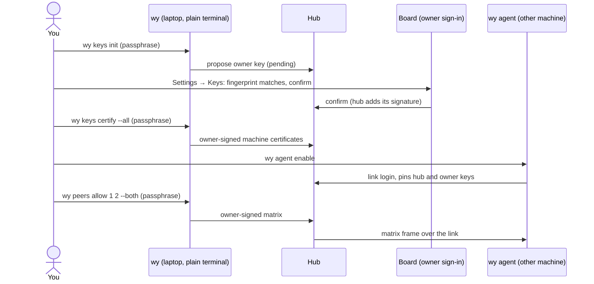
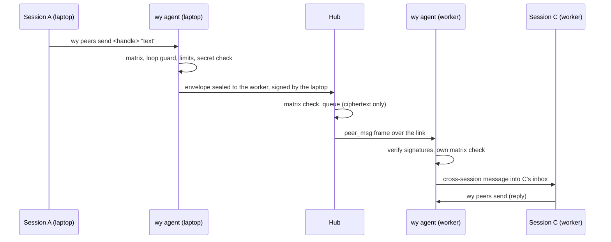

# Peers and the owner key

Claude Code's own `/peers` lets two sessions of one account on one machine message each other.
Watchyard adds every other pair: sessions in different accounts, and sessions on different
machines. You decide which accounts may talk with an account **matrix**. The hub relays sealed
messages between machines and never sees their text.

Use peers only between your own accounts and your own machines. It is not a way to pool or
share accounts between people.

The authoritative behaviour is in [peers.md](../spec/peers.md), [keys.md](../spec/keys.md) and
[link.md](../spec/link.md). This guide is the short path through them.

## Before you start

- A hub, and every machine connected to it ([install.md](install.md)).
- The Watchyard plugin installed by `wy setup` in every account folder, so the `peers` skill and
  the session hooks are there ([accounts.md](accounts.md)).
- Linux or macOS. Peers and the owner-key commands are not available on Windows (`wy peers`
  exits 3, `wy keys` refuses).
- A plain terminal that Claude Code did not start. Every command that signs with the owner key
  refuses to run inside a Claude Code session (exit 4); see [the signing guard](#the-signing-guard).

Peers on one machine work as soon as the agent runs and the matrix allows the pair. Peers
across machines also need the owner key and owner-certified machines (steps 1 to 4).

## The pieces

| Piece | What it does |
| --- | --- |
| Owner key | An Ed25519 key on one computer of yours (the owner machine, normally your laptop), sealed with a passphrase in `<state>/keys/owner.sealed`. It certifies machines, signs matrix changes that widen, and signs revocations. The hub does not hold it. |
| Hub signing key | Made by the hub at first start, kept in `<state>/hub_sign.key` on the hub machine, not in the database. It signs every frame the hub sends and every device certificate. |
| Device keys | Made on each machine by `wy agent enable` (or at pairing). Used to log in to the hub's link and to open messages sealed to that machine. |
| `wy agent` | One user service per machine. It holds the link to the hub, knows the local sessions, and is the only process that writes into another session's inbox. |
| Matrix | A signed document listing which account may start a conversation with which. |

## Set up, step by step

The board's Settings → Keys page (`#/more/keys`) shows only the step you are on, with a copy
button for the command. The steps below are the same ones.

### 1. Make the owner key

On your laptop, in a plain terminal:

```sh
wy keys init
```

1. Type a passphrase twice. It must be at least 12 characters; four random words is a good
   choice. It is never stored.
2. `wy` prints the key's fingerprint (groups like `k7q2-m4xa-...`) and a **recovery code**.
   Write the recovery code down on paper and keep it offline. `wy` asks you to type its last
   two groups back.
3. `wy` proposes the key to the hub. It is not active yet.

Check with `wy keys status`.

### 2. Confirm it

The proposal waits 24 hours for you to confirm that the fingerprint the hub received is the
one your terminal printed. Do one of these:

- **On the board.** Sign in as the owner (run `wy hub owner-link` on the hub and open the
  link), then open Settings → Keys. Compare the fingerprint and choose
  **Yes, it matches: confirm**. A board signed in without the owner link shows the page
  read-only. In the desktop app, Settings → Keys opens the same page.
- **On the hub machine:**

  ```sh
  wy hub keys show                         # the pending proposal and its fingerprint
  wy hub keys confirm-owner <fingerprint>  # only if it matches what wy keys init printed
  ```

- **Merged mode** (the hub runs on the same machine and the same state folder as
  `wy keys init`): the key is activated at once and there is nothing to confirm.

The confirmation step exists so that a stolen machine token cannot install its own owner key
on a hub that has none.

### 3. Certify the machines

```sh
wy keys certify --all      # asks for the passphrase once
wy keys status             # this device: certified
```

This owner-signs the certificate of every machine and desktop app the hub knows. Phones need
no owner signature. Settings → Keys then says which machines are still waiting, and finally
"Peers between machines can now message each other". Run it again after you add a machine.

### 4. Start the agent on every machine

On each machine that runs Claude Code (over `ssh` for a server):

```sh
wy agent enable    # makes device keys if needed, pins the hub key, installs the service
wy agent status
wy doctor          # agent and "link keys" lines
```

If `wy agent enable` stops at a hub key mismatch, it prints both fingerprints. Compare them
with `wy hub keys show` on the hub, and only if the hub's matches run
`wy agent enable --repin-hub`.

### 5. Allow accounts to talk

```sh
wy peers enable      # the agent, plus matrix version 1 if the hub has none (nothing allowed)
wy peers matrix      # numbered grid of your accounts
wy peers allow 1 2 --both
wy peers matrix      # the cell now shows the two-way arrow; the version went up
```

`allow` widens the matrix, so it shows the change and asks for the passphrase. Accounts can be
named by the number `wy peers matrix` prints, by label or by account id.

Then, in a session of account 1, ask Claude: "Use the peers skill to ask the session in
\<account 2> what folder it is in." Claude runs `wy peers list` and `wy peers send`; the other
session sees a cross-session message and answers the same way.



## How a message travels



On one machine the agent delivers directly, without the hub. The same matrix check runs in the
sender's agent, at the hub and in the receiving agent; any "no" refuses.

## The matrix

`wy peers matrix` prints rows as senders and columns as receivers:

| Cell | Meaning |
| --- | --- |
| `·` | Neither direction (the default for every pair of different accounts) |
| `→` | The row's account may start a conversation with the column's |
| `⇄` | Both ways |
| `=` | Same account, governed by the same-account switch (`wy peers same-account on` or `off`, on by default) |

Replies inside a conversation are allowed as long as the opener may still reach the other side.

### Who may change what

A change **widens** when it adds an allowed pair, turns same-account on, resumes after a pause,
or raises the turn limit (no limit counts as the highest). Everything else narrows.

| Change | Owner key at a terminal | Owner sign-in on the board or desktop app | Any paired device (phones too) or a session |
| --- | --- | --- | --- |
| Allow a pair, same-account on, resume, raise or remove the turn limit | Yes (`wy peers allow`, `same-account on`, `resume`, `max-turns`) | Yes, signed by the hub | No |
| Deny a pair, same-account off, pause, lower the turn limit | Yes | Yes | Yes, signed by the hub (`wy peers deny`, `wy peers pause`, Block all on the phone) |
| Certify a machine | Yes | No | No |
| Revoke a device | Yes (`wy keys revoke`) | Yes (Devices → Revoke) | Only itself |

Settings → Peers on the board offers the grid, **Allow all** (owner only), **Block all**, the
turn limit and the audit list. The Android app can only narrow.

**`hub_may_widen`.** By default a machine accepts a widening the hub signed for an owner
sign-in. Anyone who can read `hub_sign.key` (code running as the hub's OS user, including a
Claude Code session on the hub machine) could sign one too. If your sessions run on the hub
machine as the same user, set this on every machine so widening needs the owner key:

```sh
wy config set peers.hub_may_widen false
```

`wy doctor` warns when this applies to you.

## Limits

| Limit | Value |
| --- | --- |
| Message size | UTF-8 text only, up to 64 KB after cleaning; no attachments |
| Secret check | Refuses text that looks like a private key, a Watchyard token, an `sk-ant-` key, an AWS key id, a GitHub or Slack token. A seatbelt, not a DLP system |
| Per sending session | 10 a minute, burst 20 |
| Per session pair | 60 an hour, both directions together |
| Per hub | 2 000 a day |
| Time to live | 1 hour by default (`--ttl`, 1 minute to 24 hours). A message for a machine whose agent is offline waits that long, then expires |

**Loop guard.** Two sessions can keep replying to each other with no one typing. The turn limit
(`wy peers max-turns <2-500|none>`) stops a conversation after that many messages without a
human prompt. New matrices start with no limit; the rates above still apply. Typing in either
session, or **Resume thread** on the board, resets the count.

## Let Doorbell wake sessions (Linux)

Doorbell (the `agent-doorbell` Python package) watches for events (CI results, alerts)
and hands each one to `wy peers send tag:<tag> --stdin`. Watchyard normally refuses a send
from anything that is not a Claude Code session; Doorbell is the one program you can approve
as a trusted sender. It can send only to tags, never to a session by name, and never as a
reply. It sends as one of your accounts, so the matrix and the rate limits apply as usual.

1. Start the agent if it is not running: `wy agent enable`.
2. At a terminal on the machine Doorbell runs on (not inside a Claude Code session), run:

   ```sh
   wy peers trust doorbell
   ```

   `wy` finds `doorbell` on `PATH` (or use `--program <script or venv>`) and resolves it to
   its virtual environment and Python. It asks which account Doorbell sends as (the first
   account by default; `--account <label>` skips the question) and then asks y/N.
3. Make sure the matrix lets that account message the accounts of the sessions holding the
   tag. A session gets a tag with `wy peers tag add <tag>`.
4. Set Doorbell's handoff command to `wy peers send tag:<tag> --stdin` (add `--one` to wake
   only the first holder).

The receiving session sees `[Watchyard] from doorbell (service) on <machine> · account <label>
· tag <tag> · thread <id>`. Doorbell reads no replies.

`wy peers trust` shows the approval. To revoke it, run `wy peers trust doorbell --off` at the
terminal, or use Settings → Peers → Trusted senders → **Revoke** on the board or the Android
app. The hub refuses Doorbell's messages at once, and the machine deletes its approval the next
time it reads the directory. Only the terminal can approve it again. If you upgrade Doorbell
in the same venv, nothing changes. A different venv, or a different Python, needs a new
approval.

This is Linux only for now; on macOS and Windows `wy peers trust` says it is not supported.
It does not protect against a hostile program running as your user: such a program could
impersonate Doorbell's process tree. See
[peers.md section 4.1a](../spec/peers.md#41a-the-trusted-sender-doorbell-130).

## Turning it off

| Switch | Scope | How |
| --- | --- | --- |
| Pause all peers | Every machine | `wy peers pause`, or the switch on the board, desktop app or Android app. Resume (`wy peers resume`) widens, so it needs the owner key or an owner sign-in |
| Off on this machine | This machine, works offline | `wy peers off`, then `wy peers on` |
| Remove the agent | This machine | `wy peers disable` (same as `wy agent disable`; keys stay) |
| Block all | Matrix | Board or Android app; pairs stay off until allowed again |
| Revoke a machine | That machine | Board → Devices → Revoke, or `wy keys revoke <device>`. Its link closes and its messages are refused everywhere |

## What is logged

The hub stores metadata only: matrix versions, who messaged whom, when, size and status, pauses,
refusals and loop-guard stops. It never stores the text or a hash of it. Each agent keeps the
same metadata locally for 30 days.

```sh
wy peers status              # recent messages of this machine (metadata)
wy peers audit --since 24h   # the hub's log when your token may read it, and this machine's
```

The board shows the same under Settings → Peers → Audit.

## The signing guard

`wy keys init | certify | revoke | passwd | recover | trust-owner`,
`wy agent enable --repin-hub` and the widening `wy peers` commands refuse with exit 4 when
they run inside a Claude Code session or without a terminal. This stops a session from signing
by accident or because a message told it to. It is not a sandbox: what really protects the
owner key is the passphrase, which only you type. `wy` prints exactly what it will sign before
asking for it; read it. Details and limits: [keys.md section 8](../spec/keys.md#8-the-signing-guard).

## What the matrix does not stop

The matrix gates what Watchyard relays. Sessions run as your OS user, so on its own machine a
session could write straight into another session's inbox socket or edit Watchyard's state
files, whatever the matrix says. What it cannot do is make **another** machine deliver a pair
that machine's matrix refuses. So the matrix is a real boundary between machines, and a guard
against mistakes and injected instructions on one machine. See
[peers.md section 5.5](../spec/peers.md#55-what-the-matrix-does-not-stop).

## Recovery

| Situation | Do |
| --- | --- |
| Want a new passphrase | `wy keys passwd` |
| Lost `owner.sealed` (new laptop) | `wy keys recover` with the recovery code; same fingerprint, nothing to re-certify |
| Lost both passphrase and recovery code, or the key leaked | `wy keys init --replace`, confirm it as in step 2, then on every machine `wy keys trust-owner <new fingerprint>`, and `wy keys certify --all` |
| Check which owner key a machine trusts | `wy keys status`, `wy keys show-owner` |

There is no rotation signed by the old key, on purpose: a leaked key could sign one too.

Problems: see [troubleshooting.md](troubleshooting.md#peers-messages-are-refused).
